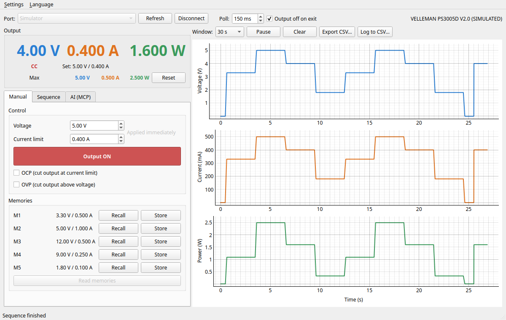
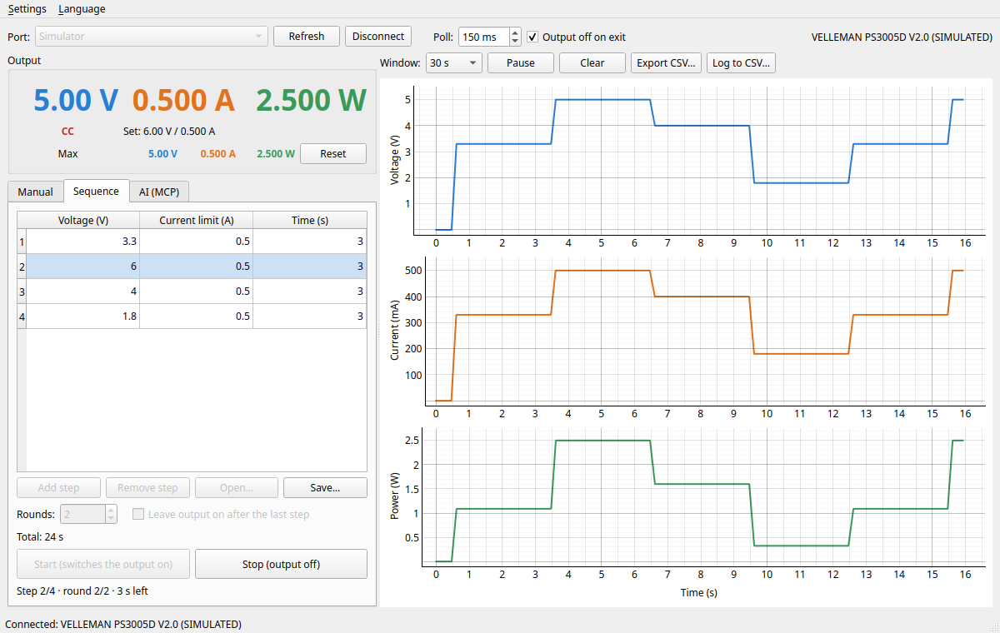
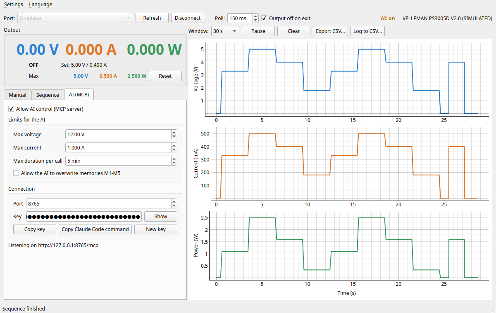

# PS3005D Control

[](https://github.com/BonBear/VellemanLabPowersupply3005D/actions/workflows/ci.yml)
[](LICENSE)


Open-source control software for the **Velleman PS3005D** programmable lab power
supply (0–30 V / 0–5 A, USB/RS232) on **Windows and Linux**: a desktop app with live
graphs, a command-line tool, and an **MCP server** so an AI agent can drive the supply
while testing hardware.



## Features

- **Live readout and graphs** of voltage, current and power, with max values since
  the last reset, CSV export and continuous CSV logging.
- **Setpoints applied immediately**, output on/off, OCP and OVP.
- **Memories M1–M5**: read, recall and store, without interrupting a running output.
- **Step sequences**: voltage / current limit / duration steps, repeated N times or
  until stopped; load/save as CSV or import the vendor app's step table.
- **AI control over MCP**, either standalone (`ps3005d-mcp`, stdio) or hosted by the
  GUI over local HTTP with a key, so you can watch the graphs and stop at any time while
  the AI works. Operator-set limits that the AI cannot raise.
- **English, Swedish and German** user interface.
- **Built-in simulator** to try everything without hardware.
- Workarounds for the firmware quirks found while testing a real unit (see below).

## Supported hardware

Developed and verified against a **Velleman PS3005D** (`*IDN?` → `VELLEMANLABPS3005DV2.0`)
over USB. The PS3005D speaks the Korad KA3005P command set, so similar single-channel
Korad/Tenma/RND supplies will probably work too, but they have not been tested.

## Installation

Requires Python 3.11 or newer. The package is not on PyPI yet; install it from GitHub:

```bash
pip install "ps3005d[gui] @ git+https://github.com/BonBear/VellemanLabPowersupply3005D"
```

The `gui` extra includes the MCP server. For the CLI and the standalone MCP server only,
use `ps3005d[mcp]`; for just the CLI, plain `ps3005d`.

**Windows:** the supply shows up as a COM port ("USB Virtual COM") with the driver built
into Windows 10/11. Start the app with `ps3005d-gui`.

**Linux:** the supply appears as `/dev/ttyACM0`. Your user needs to be in the `dialout`
group. Optionally install [docs/udev/99-ps3005d.rules](docs/udev/99-ps3005d.rules); it
stops ModemManager from probing the supply and adds a stable `/dev/ps3005d` link.

## Desktop app

```bash
ps3005d-gui                               # choose the port in the window
ps3005d-gui --port /dev/ttyACM0 --connect # or COM3 on Windows
ps3005d-gui --sim --connect               # simulator with a 10 Ω load
ps3005d-gui --lang de                     # en, sv or de (also in the Language menu)
```

- Voltage and current limit are sent as soon as you change them (arrows, or Enter after
  typing). The mouse wheel only acts on a field that has focus.
- **Memories** are read when you connect (with the output off). *Recall* sets the stored
  values directly, so a running output is not interrupted. The supply can only store a
  memory with the output off, so a *Store* with the output on is written as soon as you
  switch the output off, and the label says so until then.
- Closing the window switches the output off, unless you uncheck *Output off on exit*.

### Sequences



Enter steps (voltage, current limit, seconds), choose the number of rounds (∞ is
possible) and press *Start*, which switches the output on. *Stop*, switching the output
off, or a protection trip ends the run. The graphs keep updating during the run. The
table is remembered and can be saved as CSV (`volts,amps,seconds`).

### AI control (MCP)



Only one program can own the serial port, so the GUI can host the MCP server itself.
Enable it in the **AI (MCP)** tab, set the limits for the AI, and use
*Copy Claude Code command*, which gives a command like:

```bash
claude mcp add --transport http ps3005d http://127.0.0.1:8765/mcp --header "Authorization: Bearer <key>"
```

The server only listens on 127.0.0.1 and requires the key. While a tool runs, the toolbar
shows **AI: <tool>**. The output button and *Stop* always work.

Without the GUI, run the standalone server (stdio), for example on a test machine:

```bash
ps3005d-mcp --port /dev/ttyACM0 --max-volts 12 --max-amps 1
```

Tools, safety model and client setup are described in [docs/mcp.md](docs/mcp.md).

## Command line

```bash
ps3005d ports                           # list serial ports, marks the likely PS3005D
ps3005d probe                           # read-only check, raw replies
ps3005d status
ps3005d set -v 5 -i 0.5
ps3005d output on
ps3005d store 3 12 1.0                  # program M3 without applying it
ps3005d recall 3                        # the supply switches the output off
ps3005d monitor --interval 0.5 --csv log.csv
ps3005d sequence steps.csv --repeat 3   # switches the output on
ps3005d --sim status                    # simulator, no hardware
```

The port is auto-detected when exactly one PS3005D is connected; otherwise use `--port`
or set `PS3005D_PORT`.

## Safety

- The output is **never switched on implicitly**: not on connect, not when changing
  setpoints, not on recall.
- Setpoints are range-checked (0–30 V, 0–5 A) before anything is sent. AI clients are
  additionally limited by the operator's max voltage / current / duration.
- Run hardware tests without a load connected unless you know what the test does.
- This software controls real hardware. Use it at your own risk (see the license).

## Firmware quirks

Found while testing a real unit, and handled in the driver. Details and measurements are
in [docs/protocol.md](docs/protocol.md).

- Commands must be **paced**: 100 ms after a write and 40 ms after a query. At 50 ms,
  1 in 150 read-backs was wrong.
- `SAV<n>` **ignores n** and saves into the memory recalled last (M1 after power-on).
- After `OVP0` while OCP is on, the **status byte keeps reporting OVP on**, even across
  sessions.
- With OVP on, the supply often **cuts the output when the voltage setpoint changes**,
  so the GUI offers to switch OVP off for the duration of a sequence.
- `ISET1?` replies with a trailing junk byte.

## Development

```bash
git clone https://github.com/BonBear/VellemanLabPowersupply3005D
cd VellemanLabPowersupply3005D
python -m venv .venv
.venv/bin/pip install -e ".[dev,gui]"     # Windows: .venv\Scripts\pip ...
.venv/bin/ruff check . && .venv/bin/ruff format --check .
.venv/bin/mypy
.venv/bin/pytest                          # simulator only; GUI tests run offscreen
PS3005D_PORT=/dev/ttyACM0 .venv/bin/pytest -m hardware   # real unit, no load
```

| Path | Contents |
|---|---|
| `src/ps3005d/protocol.py`, `transport.py`, `device.py` | command set, paced serial I/O, driver |
| `src/ps3005d/sim.py` | simulator reproducing the verified behaviour |
| `src/ps3005d/sequence.py`, `controller.py` | sequences; limit-checked control for remote use |
| `src/ps3005d/mcp_server.py`, `mcp_http.py` | MCP tools (stdio and local HTTP) |
| `src/ps3005d/gui/` | PySide6 app (worker thread, panels, translations) |
| `docs/` | protocol notes, MCP guide, udev rule |

See [CONTRIBUTING.md](CONTRIBUTING.md) for guidelines and [CHANGELOG.md](CHANGELOG.md)
for changes.

## License

[MIT](LICENSE) © 2026 Björn Sjölén

Not affiliated with or endorsed by Velleman. "Velleman" and "PS3005D" are used only to
identify the hardware this software works with. The vendor's Windows software and manual
are Velleman's copyright and are not part of this repository.
